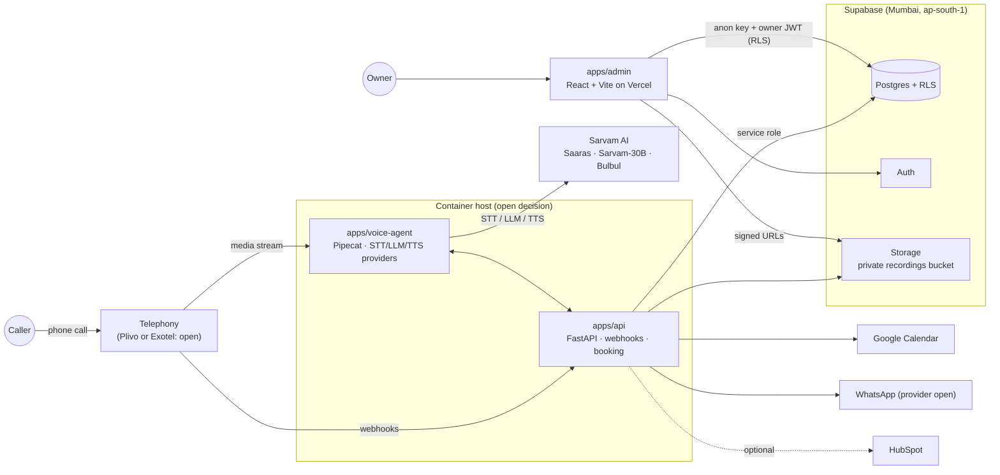

# SalesBot

An inbound AI voice receptionist for small businesses. It answers calls in **Hindi, Marathi or
English**, books appointments, captures every lead, and shows the owner what happened.

It works for any business that takes calls (clinics, salons, real estate, repair shops). A dental
clinic is the first example. There is **one generic engine** plus **industry packs** (YAML config):
intake questions, services and durations, FAQs, emergency triggers, lead stages, greeting.

The admin app is the real product: calls, leads, bookings and the revenue funnel
(calls → leads → bookings → shows → paid).

## Architecture



Why the voice agent is not on Vercel: Vercel functions are time-limited and their WebSocket
support closes at the function time limit, which drops a live phone call. Long-lived audio streams
need a long-running container. See [docs/ARCHITECTURE.md](docs/ARCHITECTURE.md).

## Quickstart

Prerequisites: [uv](https://docs.astral.sh/uv/), Node 22+, GNU Make (on Windows use Git Bash:
`winget install ezwinports.make`). For the local database only: Docker and the
[Supabase CLI](https://supabase.com/docs/guides/local-development/cli/getting-started).

```bash
cp .env.example .env               # fill in later; everything runs on mocks with it empty
cp apps/admin/.env.example apps/admin/.env
make setup                         # uv sync + npm install + git hooks
make test                          # unit tests + admin build (DB tests skip without a DB)
make dev-api                       # http://localhost:8000/health
make dev-agent                     # talk to the agent in the terminal (mock providers)
make dev-admin                     # http://localhost:5173 (needs Supabase URL + anon key)
```

The local database is deferred for now (see [docs/DECISIONS.md](docs/DECISIONS.md)). When you need it:

```bash
make db-up                         # requires Docker + Supabase CLI; prints URL and keys
make db-reset                      # applies supabase/migrations + seed.sql
# demo login: owner@demo.local / demo-password-local-only
```

## Make targets

| Target | What it does |
|---|---|
| `setup` | Install Python (uv workspace) and admin (npm) deps, install pre-commit hooks |
| `dev-api` | FastAPI with reload on :8000 |
| `dev-agent` | Voice agent text simulator with mock providers (`--demo`, `--pack salon`, `--lang hi`) |
| `dev-admin` | Admin app on :5173 |
| `db-up` / `db-down` | Start / stop local Supabase. **Requires Docker and the Supabase CLI** |
| `db-reset` | Rebuild local DB from migrations + seed. **Requires Docker and the Supabase CLI** |
| `migrate` | `supabase db push` to the **linked** remote project (linking needs approval) |
| `test` | pytest (RLS test skips without a DB) + admin build |
| `lint` | ruff check + format check, eslint + tsc |
| `format` | ruff fix + format |

## Deploying the admin app (Vercel)

Vercel deploys **only `apps/admin`**. In the Vercel project settings set **Root Directory =
`apps/admin`**. Set `VITE_SUPABASE_URL` and `VITE_SUPABASE_ANON_KEY` only. The build refuses to
run if a service role key shows up in any `VITE_` variable.

`apps/api` and `apps/voice-agent` ship as Docker images (build from the repo root:
`docker build -f apps/api/Dockerfile .`) for a long-running container host (not chosen yet).

## Folder map

```
apps/
  api/            FastAPI: /health, webhooks, booking, JWT verification, adapters (calendar, WhatsApp, CRM)
  voice-agent/    Pipecat agent: providers (stt, llm, tts, telephony), consent, emergency, handoff, engine
  admin/          React + Vite + Supabase JS: login, Calls, Leads, Knowledge base, Metrics, Setup
packages/core/    Shared Python: pack schema + loader, funnel event types, provider interfaces
packs/            Industry packs (dentist.yaml, salon.yaml)
supabase/         config.toml, migrations/ (the only schema source), seed.sql, tests/ (RLS isolation)
docs/             ARCHITECTURE, GTM, DECISIONS, PROVIDERS
```

## Status and roadmap

**Scaffold (now):** everything runs on mocks; schema, RLS and storage policies written; CI checks
lint, tests, migrations + RLS isolation against a real Supabase, and Docker builds.

Next, roughly in order:
1. Decide telephony provider and container host → first real inbound call (mock STT/LLM/TTS)
2. Sarvam STT/LLM/TTS providers from their docs → real Hindi/Marathi/English conversation
3. Persist calls, leads and funnel events; usage caps and cost per call
4. Booking against Google Calendar; WhatsApp confirmations and reminders
5. Admin: call detail with recording, lead stages, knowledge base editing, funnel metrics by source
   and script version
6. Follow-up sequences, lead scoring, optional HubSpot sync
