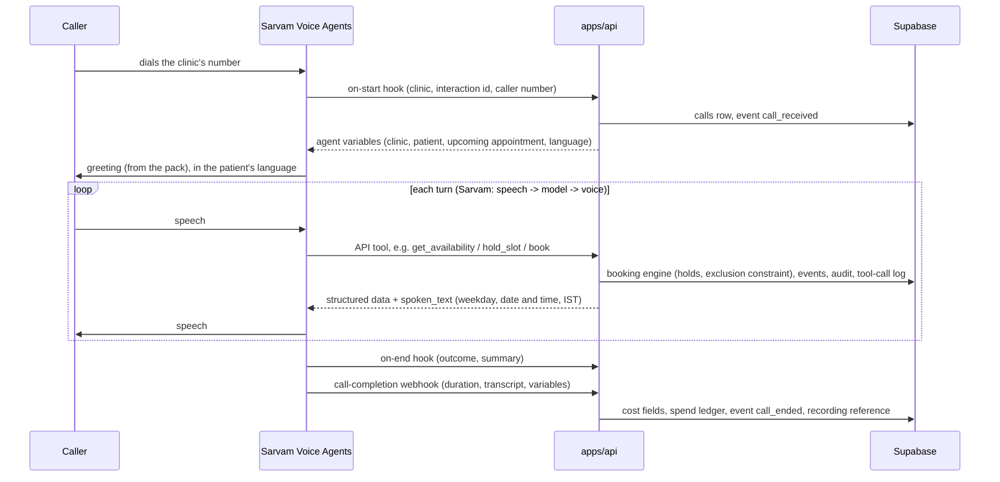

# Architecture

## Components

| Component | Runs on | Responsibility |
|---|---|---|
| Sarvam Voice Agents | Sarvam (managed) | The live call: speech recognition, language model, voice, telephony (Vobiz numbers rented from Sarvam), recording. Calls our API tools and hooks. |
| `apps/api` | Container host | Voice tools, hooks and webhooks (`salesbot_api.voice`), booking engine, intake, outbound calls (off: dry run), spend guard, WhatsApp and Google webhooks, server-side DB writes with the service role. |
| `apps/admin` | Vercel (static SPA) | Owner UI. Reads/writes Supabase directly with the anon key + owner JWT; RLS enforces isolation. |
| `packages/core` | Library | Packs (schema, loader, agent generator), flow engine, text and language, scheduling, costs and rates, voice lines and tool specs. |
| `packs/` | Config | One YAML per industry. All industry-specific behaviour, including the voice agent's instruction and spoken lines. |
| Supabase | Managed (Mumbai) | Postgres (schema via migrations), Auth (owner logins), Storage (private bucket kept for optional recording copies). |

We run no voice pipeline: no speech models, WebRTC or telephony code. Everything the business
depends on (who the patient is, what is free, what was booked, what it cost) is decided and stored
on our side, so Sarvam can be replaced by another voice platform that can call HTTP tools.

## Inbound call flow

Emergency: the instruction (rendered from the pack) tells the agent to say the emergency line
with the clinic phone and emergency numbers, then call `create_staff_task` with urgency `urgent`.
Our side records the staff task plus `handoff_task_created` and `emergency_detected` events.

## Outbound calls

`salesbot_api.voice.outbound.request_call` checks the appointment, the patient's call opt-in and
consent, the clinic's call window and quiet hours, attempts and spacing. Real calls need both
`OUTBOUND_CALLS_ENABLED=true` and the clinic policy (pinned off in the schema), and then reserve
their worst-case cost against the spend caps. Otherwise the request is a **dry run**: logged and
recorded as a `dry_run` call, never dialled.

## Data flow

- **Writes from calls** go through `apps/api` with the service role (bypasses RLS, so every query
  filters by `business_id` explicitly).
- **Owner reads/writes** go from the admin app straight to Supabase; RLS limits rows to the owner's
  business(es) via `business_members`.
- **Funnel metrics** come from the append-only `events` table, never from mutable rows. Voice
  events carry `channel = voice`, the language and the Sarvam interaction id; bookings made on a
  call carry its `call_id`, so cost per confirmed appointment can be computed.
- **Costs**: `calls.agent_minutes` and `telephony_pulses` are derived from the duration in
  Sarvam's end-of-call payload; `cost_inr_estimate` uses `packages/core/.../costs/rates.yaml`
  (docs/COSTS.md). Spend per call is logged and written to `spend_ledger`.
- **Recordings** stay with Sarvam. We store `calls.recording_ref` (how to fetch it through the
  Analytics API), never the audio.

## Where providers plug in

| Layer | Interface | Implementations | Env |
|---|---|---|---|
| Voice platform (inbound) | HTTP: `/api/v1/voice/tools/*`, `/hooks/*`, `/webhooks/{token}/*` | Sarvam Voice Agents | `VOICE_TOOL_SECRET`, `VOICE_WEBHOOK_SECRET` |
| Outbound calls | `OutboundCallAdapter` | `DryRunOutboundAdapter` (default), `SarvamOutboundAdapter` | `OUTBOUND_CALLS_ENABLED`, `SARVAM_*` |
| Call analytics | `AnalyticsClient` | `NoAnalytics`, `SarvamAnalytics` (read-only) | `SARVAM_*` |
| Calendar | `CalendarAdapter` | `MockCalendar`, `GoogleCalendar` (TODO) | Google OAuth vars |
| Messaging | `MessagingAdapter` | `MockMessaging` | `WHATSAPP_*` |
| CRM | `CRMAdapter` | `NoopCRM`, `HubSpotCRM` (TODO) | `HUBSPOT_ENABLED` |

## Hosting

Vercel serves only the static admin app. `apps/api` must be always on with low latency, because
Sarvam calls its tools mid-conversation (aim: under 2 seconds per tool) and posts webhooks; it
runs as a Docker container on a long-running host (choice open, see DECISIONS.md).

## Multi-tenancy

`businesses` ← `business_members(user_id, business_id, role)` → `auth.users`. Every business-data
table has `business_id` and RLS policies using `is_business_member()` /
`has_business_role()` / `has_staff_access()` (SECURITY DEFINER, pinned `search_path`). `anon` has
no table access at all. Proven by `supabase/tests/rls_isolation.sql` in CI. Voice tools find the
clinic from the agent's `clinic_slug` variable; one shared tool secret covers all clinics for the
pilot (per-clinic secrets are a later option).
