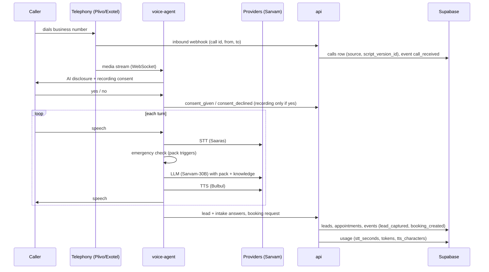

# Architecture

## Components

| Component | Runs on | Responsibility |
|---|---|---|
| `apps/voice-agent` | Container host (long-running) | Live call: audio in → STT → engine (+LLM) → TTS → audio out. Consent, emergency, handoff. |
| `apps/api` | Container host | Telephony/WhatsApp/Google webhooks, booking logic, server-side DB writes with the service role, JWT verification for admin → API calls. |
| `apps/admin` | Vercel (static SPA) | Owner UI. Reads/writes Supabase directly with the anon key + owner JWT; RLS enforces isolation. |
| `packages/core` | Library | Pack schema/loader, funnel event types, provider interfaces. Shared by api and agent. |
| `packs/` | Config | One YAML per industry. All industry-specific behaviour lives here. |
| Supabase | Managed (Mumbai) | Postgres (schema via migrations), Auth (owner logins), Storage (private recordings). |

## Call flow

Emergency: if a pack trigger matches, the agent requests a handoff. If no human is reachable (or
handoff is not configured), it takes a **callback request** so the lead is never lost.

## Data flow

- **Writes from calls** go through `apps/api` with the service role (bypasses RLS, so every query
  filters by `business_id` explicitly).
- **Owner reads/writes** go from the admin app straight to Supabase; RLS limits rows to the owner's
  business(es) via `business_members`.
- **Funnel metrics** come from the append-only `events` table, never from mutable rows.
  `calls.script_version_id` and `source` let us split conversion by script and by channel.
- **Recordings** are uploaded server-side to `recordings/{business_id}/{call_id}.wav`; the admin
  gets signed URLs.

## Where providers plug in

| Layer | Interface (`salesbot_core.providers`) | Implementations (`apps/voice-agent/.../providers`) | Env |
|---|---|---|---|
| Hearing (STT) | `STTProvider` | `MockSTT`, `SarvamSTT` (TODO) | `STT_PROVIDER` |
| Thinking (LLM) | `LLMProvider` | `MockLLM`, `SarvamLLM` (TODO) | `LLM_PROVIDER` |
| Voice (TTS) | `TTSProvider` | `MockTTS`, `SarvamTTS` (TODO) | `TTS_PROVIDER` |
| Telephony | `TelephonyAdapter` | `MockTelephony`, `BrowserTestCall` (placeholder) | `TELEPHONY_PROVIDER` |
| Calendar | `CalendarAdapter` (api) | `MockCalendar`, `GoogleCalendar` (TODO) | Google OAuth vars |
| Messaging | `MessagingAdapter` (api) | `MockMessaging` | `WHATSAPP_PROVIDER` |
| CRM | `CRMAdapter` (api) | `NoopCRM`, `HubSpotCRM` (TODO) | `HUBSPOT_ENABLED` |

Every result object carries usage (`audio_seconds`, `tokens_in/out`, `characters`) so per-call cost
is always recorded.

The engine (`salesbot_agent.engine.Receptionist`) is plain Python and fully testable. The Pipecat
processor (`salesbot_agent.pipeline.ReceptionistProcessor`) wraps it: transcription frames in,
speech frames out.

## Why voice is off Vercel

A phone call is a continuous bidirectional audio stream that lasts minutes. Vercel functions have
execution time limits and their WebSocket support is beta and closes at the function time limit,
which would cut calls mid-conversation. Serverless cold starts also add latency to the first
words. The voice agent and API therefore run as Docker containers on a long-running host (choice
open, see DECISIONS.md). Vercel serves only the static admin app.

## Multi-tenancy

`businesses` ← `business_members(user_id, business_id, role)` → `auth.users`. Every business-data
table has `business_id` and RLS policies using `is_business_member()` /
`has_business_role()` (SECURITY DEFINER, pinned `search_path`). `anon` has no table access at
all. Proven by `supabase/tests/rls_isolation.sql` in CI.
